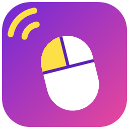
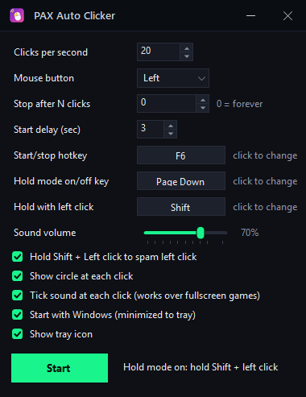

<p align="center">
  
</p>

# pxd Auto Clicker

**A small Windows auto clicker that stays out of your way.** Click at a set rate with a hotkey, or hold a key and the left mouse button to spam clicks only while you want them. It lives in the tray, starts with Windows if you like, and tells you with a sound when it turns on or off, even over a fullscreen game.

<p align="center">
  
</p>

## Features

- **Two ways to click.**
  - **Start/stop:** press the hotkey (F6 by default) and it clicks on its own at the rate you set, after an optional start delay, until you press it again or it reaches a click count you chose.
  - **Hold mode:** while it's on, hold **Shift + left click** and it spams left clicks for as long as you hold both. Let go and it stops. Turn hold mode on and off with **Page Down**.
- **Every key can be changed.** Click a key button in the window and press the key you want (Esc cancels). The key you press to bind isn't passed on, so binding doesn't trigger anything.
- **Bare keys stay bare.** The hold-mode key only works on its own, so another app's **Ctrl + Page Down** (or Alt/Shift/Win + the same key) never toggles it.
- **Up to 500 clicks per second**, left, right or middle button, with even timing.
- **Sounds you can hear over games.** A rising chime when hold mode turns on and a falling one when it turns off, with a volume slider (0 turns them off). They play through the normal Windows mixer, so they show up in the volume mixer.
- **See or hear every click.** A green ring flashes where each click lands. Fullscreen games hide windows drawn on top of them, so there's also an optional soft **tick sound** for each click.
- **See when it's on.** A small dot rides just below-right of the mouse pointer while the clicker is on: green while hold mode is armed, amber while the start/stop clicker is running. It shows over the desktop and over games in borderless or windowed mode (it keeps itself on top), but not over games in exclusive fullscreen, which cover every other window; the chimes and tick still work there. Turn it off with **Dot by the mouse pointer while it's on**.
- **Shift + F12** shows or hides the window from anywhere, including from inside a game.
- **Tray app.** Minimizing, the window's **X**, Alt+F4 and the taskbar's Close all hide it to the tray instead of quitting, so it keeps working in the background; double-click the tray icon or use its menu to bring it back. To quit, use the **Exit** button in the window or **Exit** in the tray menu. Untick **Show tray icon** to run without one: minimizing then keeps it on the taskbar, and starting the exe again opens the window.
- **One copy at a time.** Starting it again while it runs brings up the running window. The window remembers where you left it.
- **Works with [pxd Toolkit](https://github.com/joshpack/pxdToolkit)**, including turning the tray icon on or off from there.
- **Start with Windows**, optional. It starts silently, the way you left it: hold mode on or off, and the window open or in the tray. The very first time, hold mode is on and the window is in the tray.
- **Remembers its last state.** Hold mode on or off and whether the window was open come back after an update (from pxd Toolkit or its own self-update), a restart or Windows starting. The start/stop clicker always comes back stopped, so it never starts clicking on its own. Opening the exe yourself always shows the window. Settings are saved a second after each change, so nothing is lost even if an update has to stop it.
- **No install, no admin rights.** One folder; settings live in the current user's registry.

## Supported systems

| System | Status |
| --- | --- |
| Windows 11, x64 | **Tested**, in daily use |
| Windows 10, x64 | Should work, untested |

It uses Windows-only APIs (low-level keyboard and mouse hooks, `SendInput`, global hotkeys), so there's no Linux or macOS version.

## Install

1. Install the **[.NET 10 Desktop Runtime](https://dotnet.microsoft.com/download/dotnet/10.0)** (x64) if you don't have it.
2. Download `pxdAutoClicker-1.3.2-win-x64.zip` from **[the latest release](https://github.com/joshpack/pxdAutoClicker/releases/latest)**. To check it in PowerShell, run `Get-FileHash pxdAutoClicker-1.3.2-win-x64.zip` and compare the result with the `.sha256` file next to it.
3. Unzip it somewhere permanent. It contains one folder, `pxdAutoClicker`. Your settings live elsewhere and are kept when it updates.
4. Run `pxdAutoClicker.exe`.

The exe isn't code-signed, so SmartScreen may warn the first time: choose **More info → Run anyway**.

**Updates:** each time it starts, it checks the latest release on GitHub first (for at most 4 seconds). If there's a newer one, it downloads it, checks its `.sha256`, replaces its own files and starts again with the same options. Offline or when GitHub is slow, it just opens. `--no-update` or the environment variable `PXD_NO_UPDATE=1` turns this off.

**Games running as administrator:** Windows doesn't let a normal program send clicks or read keys in a program running as administrator. If a game runs elevated, run pxd Auto Clicker as administrator too.

## Keys at a glance

| Key | Does | Change it |
| --- | --- | --- |
| F6 | Start/stop automatic clicking | **Start/stop hotkey** |
| Page Down | Turn hold mode on or off (with a chime) | **Hold mode on/off key** |
| Shift (held) + left click | Spam left clicks while hold mode is on | **Hold with left click** |
| Shift + F12 | Show or hide the window | Fixed |

If another program already uses the start/stop key or Shift + F12, the status line says so; pick a different key.

## Command line

| Option | What it does |
| --- | --- |
| `--autostart` | Starts with no chime, restoring the last state: hold mode on or off, and the window open only if it was open (the first time: hold mode on, in the tray). "Start with Windows" and pxd Toolkit use this. |
| `--no-update` | Opens without checking for a newer release first. |
| `--self-test` | Checks the one-time move from the app's earlier name (in a scratch registry key and a temp folder) and updating (against a fake release on a local server, in a temp folder); no window, real settings and install untouched. Prints PASS/FAIL lines; the exit code is the number of failures. |

## Settings

Settings, the window position and the last state (`HoldOn`, `WindowOpen`) are saved a second after each change and when the app closes, in the registry under `HKEY_CURRENT_USER\Software\pxdAutoClicker`. Whether the tray icon shows is kept in `%APPDATA%\pxd\toolkit.json` (`apps.pxdAutoClicker.trayIcon`), shared with pxd Toolkit. "Start with Windows" is the `pxdAutoClicker` value under `HKEY_CURRENT_USER\Software\Microsoft\Windows\CurrentVersion\Run`. Settings from older builds, under the app's earlier names, are picked up automatically: on its first start, 1.3.0 moves them, an existing "Start with Windows" entry and the pxd Toolkit setting to the names above.

## Uninstall

Untick **Start with Windows**, quit (the **Exit** button in the window, or **Exit** in the tray menu), and delete the folder. To remove the settings too, delete `HKEY_CURRENT_USER\Software\pxdAutoClicker`.

## Build from source

Needs the [.NET 10 SDK](https://dotnet.microsoft.com/download/dotnet/10.0).

```powershell
dotnet build -c Release
dotnet publish -c Release -r win-x64 --self-contained false -o publish\pxdAutoClicker
```

## Code layout

Everything is in `Program.cs`:

- `ClickerForm`: the window, settings, hotkeys, the keyboard hook that handles the bindable keys, the hold-mode mouse hook and click loop, and the chimes and tick, which are synthesized in memory as WAV data (no sound files).
- `ClickRing`: a click-through, transparent overlay that flashes a fading ring where each click lands.
- `pxdTitleBar`: the dark pxd title bar (icon, name, minimize and close) that replaces the Windows one.
- `SingleInstance`, `pxdLink`, `pxdPlacement`: one copy at a time, the pxd Toolkit tray-icon setting, and the saved window position.
- `pxdMigrate`, `SelfTest`: the one-time move from the app's earlier name, and its `--self-test`.

`app.ico` is the icon, built into the exe and used for the window and tray.
